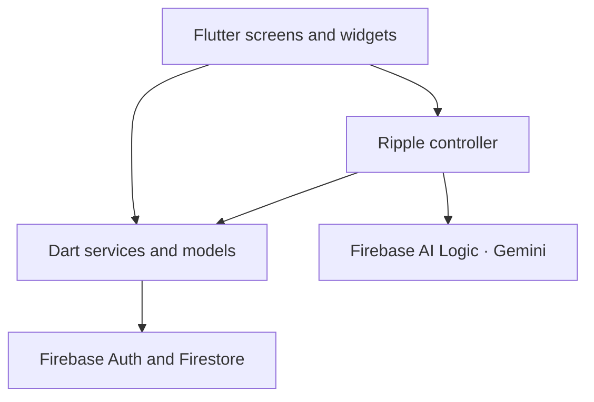

<div align="center">


# Flow

### Money, in a better flow.

A Flutter expense tracker that brings spending, budgets, bills and savings into one calm workspace—with **Ripple**, a Gemini-powered assistant for understanding your money and reviewing proposed changes.


**Track clearly. Plan ahead. Ask Ripple.**

[Explore features](#what-you-can-do) · [Meet Ripple](#meet-ripple) · [Run locally](#run-locally) · [Architecture](#architecture) · [Report an issue](https://github.com/darshachamika/Expense_tracker/issues)

</div>

---

## A clearer view of everyday money

Flow combines an animated water-inspired interface with practical expense management. A blue–cyan palette, floating bubbles, a video introduction and light/dark themes give the app its identity; recorded expenses and planning tools give it purpose.

**Current focus:** Android and web development. Platform folders are included for other Flutter targets, but their authentication, plugins and release setup need separate validation.

[Watch the bundled Flow intro](assets/videos/flow_intro.mp4)

## What you can do

| Area | Experience |
| :--- | :--- |
| **Home** | See monthly spending, budget remaining, recent activity, bill previews and savings progress. |
| **Expenses** | Add, edit and delete expenses with a date, category, payment method and optional note. Search and filter recorded activity. |
| **Insights** | Explore month, year and all-time summaries, category breakdowns and doughnut visualizations. |
| **Budgets** | Set monthly budgets and category limits; compare recorded spending with your plan. |
| **Planned bills** | Track due dates, payment state and recurring bills, with supported undo operations. |
| **Savings goals** | Manage goals, record contributions and follow progress independently of spending totals. |
| **Purchase simulator** | Explore how a proposed purchase could affect your budget before recording an expense. |
| **Profile** | Edit personal details and profile photo, choose an appearance and customize dashboard preferences. |
| **Authentication** | Sign in with Google or email/password, create an account and request a password reset. |
| **Ripple** | Ask about recorded finances in English or Sinhala and review AI-proposed category, budget and expense changes. |

### Designed to feel like Flow

- Full-screen video introduction with timeout and failure fallbacks.
- Floating water bubbles and a glowing logo, with lifecycle-aware animation handling.
- Light and dark appearances, responsive action layouts and reduced-motion support.
- A floating Ripple entry point, animated panel and glowing answer presentation.

## Meet Ripple

**Your spending, explained.** Ripple is a focused assistant inside Flow, with separate advice and action modes.

| Mode | What happens |
| :--- | :--- |
| **Advice** | Reads a financial snapshot and explains the recorded spending, budget, bills or active goals. |
| **Create category** | Proposes a category for you to inspect before saving. |
| **Update budget** | Prepares a budget proposal for explicit confirmation. |
| **Add expense** | Prepares expense fields for review before a confirmed write. |

Example prompts:

> Which categories have the highest spending?
>
> Summarize my spending this month.
>
> Explain my active savings goal progress in Sinhala.

### How a request works

1. Flow loads recorded data for the signed-in user.
2. Dart calculates the financial summary before sending it to the model.
3. Ripple explains the snapshot or prepares a proposal for the selected action mode.
4. You review and confirm proposed changes before the corresponding service saves them.

The advice snapshot excludes expense titles and notes. It includes financial summaries and category, bill and active goal names. Your question is also sent to Gemini; action requests can contain the details needed to prepare a proposal. Each advice question is independent.

If data loading fails, the advice flow stops before requesting a model response. AI responses should be checked against your records before making a financial decision.

## Money rules that matter

- Monetary amounts are represented in integer minor units in the data models.
- Recorded expenses drive spending totals.
- Creating a planned bill does not immediately record an expense; marking a bill paid uses the bill payment flow.
- Savings contributions are tracked separately from expenses. Archiving a goal does not rewrite spending history.
- The purchase simulator previews a scenario without recording the proposed purchase as an expense.

## Architecture

The app separates presentation, advisor session state, data services and typed models.



| Location | Responsibility |
| :--- | :--- |
| `lib/screens/` | Authentication, dashboard, profile, expenses and planning screens. |
| `lib/widgets/` | Reusable Flow visuals, charts, startup gates and advisor panel. |
| `lib/controllers/` | Ripple session state and confirmation orchestration. |
| `lib/services/` | Firebase access, summaries, simulation and advisor planning/write services. |
| `lib/models/` | Typed records, period summaries, advisor snapshots and action proposals. |
| `lib/theme/` | Flow colors, typography and appearance settings. |
| `test/` | Model, action, controller/panel and presentation tests. |
| `assets/` | Launcher artwork and introduction video. |

User records are organized below `users/{uid}`, including `expenses`, `categories`, `budgets`, `plannedBills`, `savingsGoals` and `profile/main`. Savings contributions sit below their associated goal.

## Run locally

### 1. Get the project

Install Flutter with a bundled Dart SDK compatible with the constraint in `pubspec.yaml` (currently `^3.13.0`). Android development also needs the Android SDK and an emulator or connected phone. Web development needs a supported browser.

```bash
git clone https://github.com/darshachamika/Expense_tracker.git
cd Expense_tracker
flutter pub get
flutter doctor
```

### 2. Connect your Firebase project

Use your own Firebase project for development:

1. Register the Android and web apps you intend to run.
2. Enable **Email/Password** and **Google** in Firebase Authentication.
3. Create a Cloud Firestore database.
4. Install Firebase CLI and FlutterFire CLI, then run:

   ```bash
   firebase login
   flutterfire configure
   ```

5. Verify the generated `lib/firebase_options.dart` and Android `android/app/google-services.json` refer to your project and package name.
6. Configure Firebase AI Logic and an available Gemini model if using Ripple. Advisor services accept the `GEMINI_MODEL` Dart define; verify availability for your project.
7. Review `firestore.rules` for every feature you enable before deployment. The checked-in rules are not a complete production policy for all write flows; restrictive rules can prevent profile and planning operations. Keep access scoped to the authenticated owner.

For Android Google login, register the SHA-1 fingerprint of the certificate signing your installed build in Firebase and download the updated `google-services.json`. Register the Play app-signing fingerprint as well when distributing through Google Play.

### 3. Configure web App Check

The current startup code activates App Check on **web**. Register a web debug token in Firebase App Check for local development. Keep the token in a local file outside the repository:

```json
{
  "APP_CHECK_WEB_DEBUG_TOKEN": "YOUR_REGISTERED_WEB_DEBUG_TOKEN"
}
```

Run with its path:

```bash
flutter run -d edge --dart-define-from-file="PATH_TO_LOCAL_CONFIG.json"
```

For a web release, provide the registered reCAPTCHA site key:

```bash
flutter build web --dart-define=APP_CHECK_RECAPTCHA_SITE_KEY=YOUR_SITE_KEY
```

Android App Check activation is not implemented in the current startup path. Configure and validate the appropriate Android provider before depending on enforced App Check services in a distributed build.

### 4. Launch on Android

Enable USB debugging on your phone, connect it and accept the debugging prompt:

```bash
flutter devices
flutter run -d YOUR_ANDROID_DEVICE_ID
```

## Checks and builds

Run the analyzer and test suite:

```bash
flutter analyze
flutter test
```

Tests cover areas including spending summaries, advisor snapshots and confirmed actions, bills and savings, startup behavior, animation lifecycle, responsive layouts and payment-label contrast. These commands are local validation steps; this README does not claim a passing CI run.

Regenerate the launcher icon after changing its source artwork:

```bash
dart run flutter_launcher_icons -f flutter_launcher_icons.yaml
```

Build an APK for device testing:

```bash
flutter build apk --release
```

Output: `build/app/outputs/flutter-apk/app-release.apk`

Build an Android App Bundle after configuring release signing:

```bash
flutter build appbundle --release
```

Output: `build/app/outputs/bundle/release/app-release.aab`

<details>
<summary><strong>Troubleshooting: Android Google login</strong></summary>

If the account chooser opens but login does not finish, inspect the Android error log and verify the package name, signing certificate SHA-1 and OAuth configuration. On Windows, obtain signing fingerprints with:

```powershell
cd android
.\gradlew.bat signingReport
```

Use the certificate for the build you actually installed. After updating Firebase, download the new configuration and rebuild.

</details>

<details>
<summary><strong>Troubleshooting: Kotlin “different roots” cache error</strong></summary>

On Windows, a project on one drive and the Pub cache on another can trigger the observed Kotlin incremental cache error. The project uses `kotlin.incremental=false` in `android/gradle.properties` as a workaround. After stopping the build and Gradle daemon, a clean rebuild can clear the affected project outputs:

```bash
flutter clean
flutter pub get
flutter build apk --release
```

</details>

## Release status

Flow is under active development. Before publishing, configure a permanent application ID and release signing, validate Android authentication and App Check, complete Firestore access rules, and test the actual distributed build. The current Android release configuration uses a debug signing key.

Privacy disclosures, account/data deletion, store listing assets and Play Console declarations also need to reflect the final app behavior. No Play Store availability or production security audit is implied by this repository.

## Contributing

Found a bug or have a focused improvement? [Open an issue](https://github.com/darshachamika/Expense_tracker/issues) with reproduction steps, expected behavior and your device/platform. For code changes, use a feature branch, run relevant checks and explain the behavior changed in your pull request.

Keep debug tokens, signing keys, passwords and service-account credentials out of commits and issue logs.

---

<div align="center">

**Built by [Darsha Chamika Sudusinghe](https://github.com/darshachamika)**

Flutter · Firebase · Gemini

**Flow — Money, in a better flow.**

</div>
